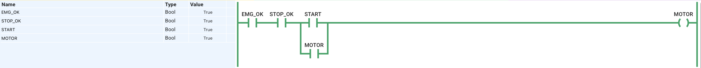
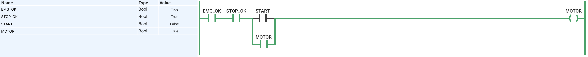
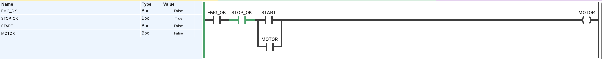
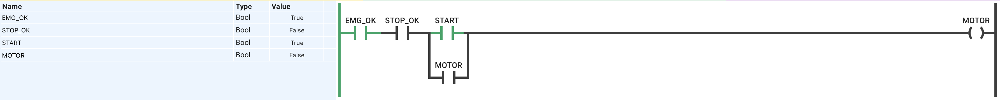
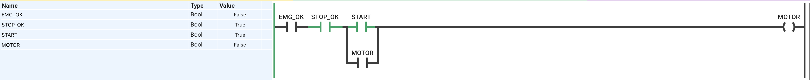

# Semana 6 - CLP e linguagem Ladder

## Objetivo
Programar em Ladder a partida de um motor com selo (retenção), parada e emergência, e validar com testes.

## Link do programa
- PLC Simulator Online: https://app.plcsimulator.online/TnU6UythC4OvRpn9WPnp

## Tags
| Tag | Tipo | Significado |
|---|---|---|
| START | entrada (Bool) | botão de partida. 1 = apertado |
| STOP_OK | entrada (Bool) | 1 = botão de parar solto (ok). 0 = alguém apertou parar |
| EMG_OK | entrada (Bool) | 1 = sem emergência (ok). 0 = emergência acionada |
| MOTOR | saída (Bool) | 1 = motor comandado para ligar |

## Lógica

```
|──[EMG_OK]──[STOP_OK]──┬──[ START ]──┬──( MOTOR )──|
                        │             │
                        └──[ MOTOR ]──┘
```

Em expressão: `MOTOR = EMG_OK · STOP_OK · (START + MOTOR)`


- O START liga o motor.
- O contato MOTOR, em paralelo com o START, faz o selo: depois que o motor liga, ele mesmo segura o caminho e o motor continua ligado quando o START é solto.
- EMG_OK e STOP_OK ficam antes da divisão do ramo. Assim eles cortam o caminho do START e o caminho do selo ao mesmo tempo. Se ficassem só num dos ramos, o motor não desligaria.
- Depois de uma parada ou emergência, o selo cai. O motor só volta a ligar com um novo aperto no START.

## Testes
| ID | Situação inicial | Ação | Esperado | Obtido | Situação |
|---|---|---|---|---|---|
| T01 | EMG_OK=1, STOP_OK=1, MOTOR=0 | START=1 | MOTOR=1 | MOTOR=1 | PASSA |
| T02 | MOTOR=1 | START=0 | MOTOR=1 (selo) | MOTOR=1 | PASSA |
| T03 | MOTOR=1 | STOP_OK=0 | MOTOR=0 | MOTOR=0 | PASSA |
| T04 | MOTOR=1 | EMG_OK=0 | MOTOR=0 | MOTOR=0 | PASSA |
| T05 | EMG_OK=0, MOTOR=0 | START=1 | MOTOR=0 | MOTOR=0 | PASSA |
| Extra | EMG_OK=1, START=1 | STOP_OK=0 | MOTOR=0 | MOTOR=0 | PASSA |

O teste extra mostra que, mesmo com o START apertado, o STOP vence.

## Prints






## O que errei e corrigi
Na primeira montagem a bobina se chamava BOBINA e o contato do selo se chamava MOTOR. Como eram variáveis diferentes, o selo não funcionava. Corrigi colocando o mesmo nome (MOTOR) na bobina e no contato.

## Limitações
Isso foi só simulação. O MOTOR=1 mostra que o programa mandou ligar, mas não prova que o motor girou de verdade. Numa máquina real, a emergência precisa de hardware de segurança próprio (relé de segurança) e não pode depender só do programa do CLP. Não testei sobrecarga (OL_OK) nem as indicações RUN e READY, que eram exercícios adicionais.
