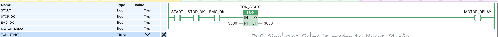
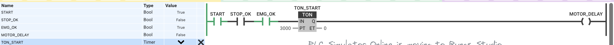
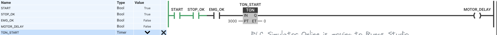
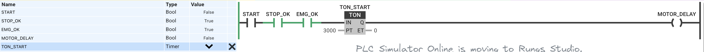

# Semana 7 - Programação sequencial de CLP

## Objetivo
Programar em Ladder uma partida com atraso: o motor só liga depois que o START fica acionado por 3 segundos. STOP e emergência interrompem a contagem e desligam o motor.

## Link do programa
- PLC Simulator Online: https://app.plcsimulator.online/ly45HoSMkGrxvUeAhY4d

## Tags
| Tag | Tipo | Significado |
|---|---|---|
| START | Bool | botão de partida. 1 = acionado |
| STOP_OK | Bool | 1 = parada não acionada (ok). 0 = alguém apertou parar |
| EMG_OK | Bool | 1 = sem emergência (ok). 0 = emergência acionada |
| MOTOR_DELAY | Bool | 1 = motor comandado para ligar |
| TON_START | Timer | temporizador de 3 s (PT = 3000 ms) |

## Como o temporizador TON funciona
- IN: entrada. Enquanto IN = 1, o timer conta.
- PT: tempo programado (3000 ms = 3 s).
- ET: tempo que já passou.
- Q: vira 1 quando ET chega em PT.
- Se IN desligar antes do tempo, ET volta a 0. O TON não continua de onde parou.

## Lógica
```
|──[START]──[STOP_OK]──[EMG_OK]──[ TON_START  PT=3000 ]──( MOTOR_DELAY )──|
                                   IN            Q
```

START, STOP_OK e EMG_OK ficam em série na entrada do timer. A bobina MOTOR_DELAY fica ligada na saída Q.

O material do professor mostra a solução em dois rungs (um para o timer e outro com TON_START.Q comandando o motor). Neste simulador o bloco TON tem a saída Q na própria linha, então fiz tudo em um rung só. O comportamento é o mesmo: se STOP_OK ou EMG_OK vira 0, a entrada IN desliga, o timer zera e o Q cai junto com o motor.

## Testes
| ID | Ação | Esperado | Obtido | Situação |
|---|---|---|---|---|
| T01 | START por ~2 s e depois START=0 | ET volta a 0, motor=0 | ET voltou a 0, motor=0 | PASSA |
| T02 | START mantido por 3 s | Q=1, motor=1 | ET=3000, Q=1, motor=1 | PASSA |
| T03 | STOP_OK=0 | ET=0, motor=0 | ET=0, motor=0 | PASSA |
| T04 | EMG_OK=0 com motor ligado | motor=0 | motor=0 | PASSA |
| T05 | EMG_OK volta a 1 com START=0 | motor continua 0 | motor=0 | PASSA |

No T05 é importante deixar o START em 0 antes de liberar a emergência. Se o START ainda estiver em 1, o timer começa a contar de novo e o motor liga depois de 3 s.

## Prints





## Limitações
- Neste programa não tem selo: o motor fica ligado enquanto o START estiver em 1. Se o START voltar a 0, o motor desliga.
- O tempo do simulador pode variar um pouco por causa do ciclo de varredura, então os 3 s são aproximados.
- É só simulação. MOTOR_DELAY = 1 mostra que o programa mandou ligar, mas não prova que o motor girou. Numa máquina real a emergência precisa de hardware de segurança próprio.
- Não fiz as extensões (pisca-pisca, contador de lote, reset e conversão do GRAFCET), que eram adicionais.
